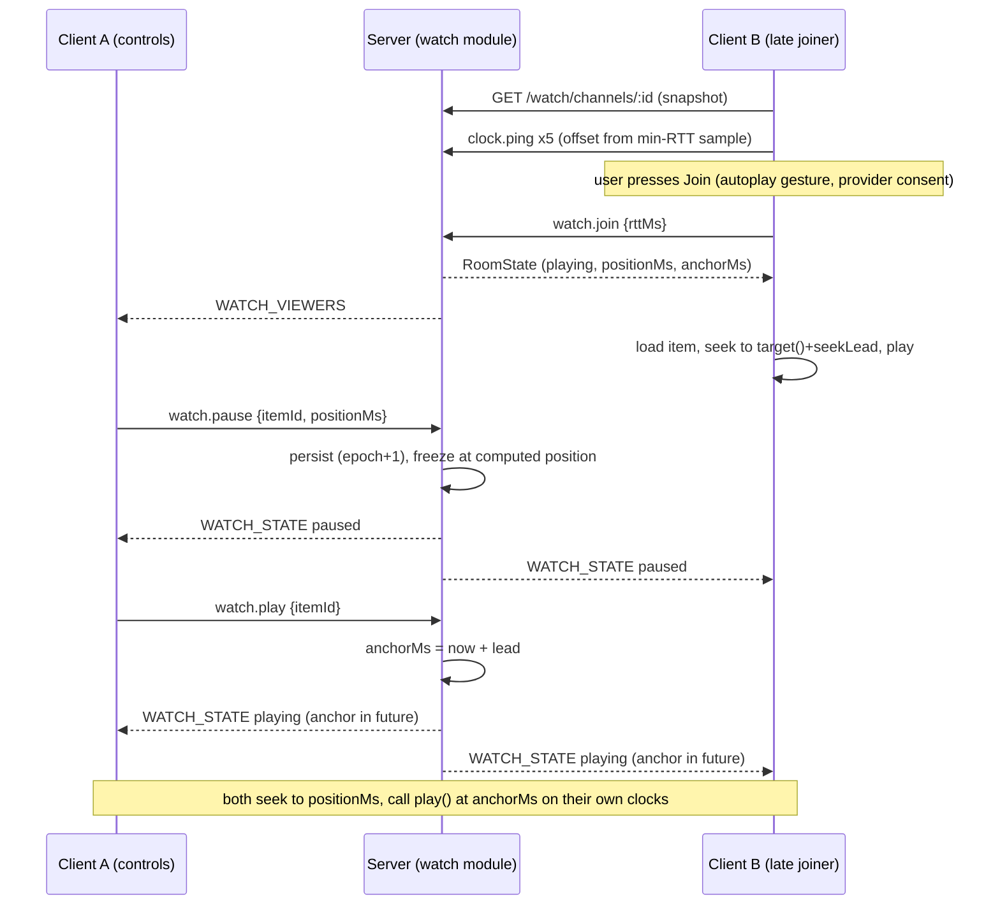
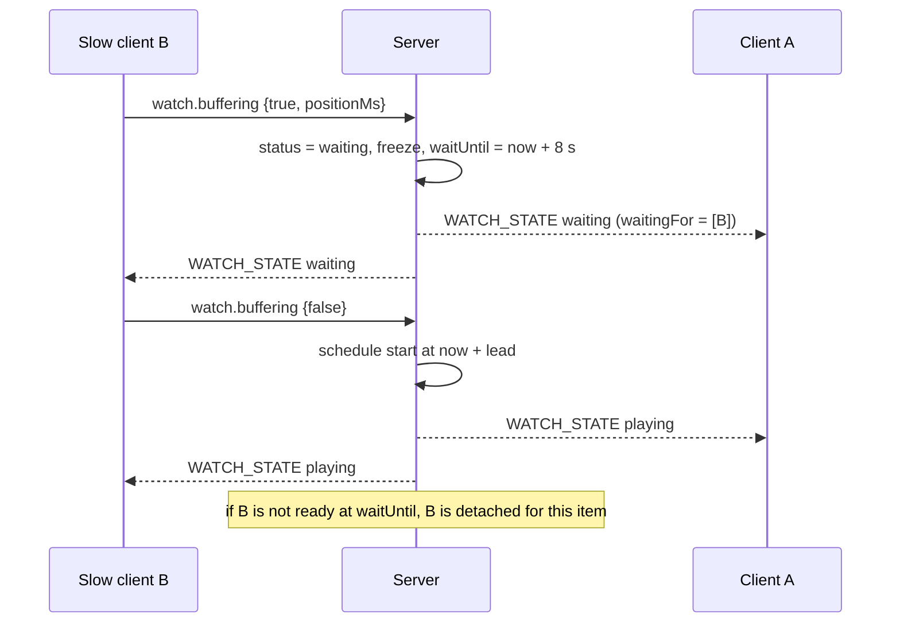
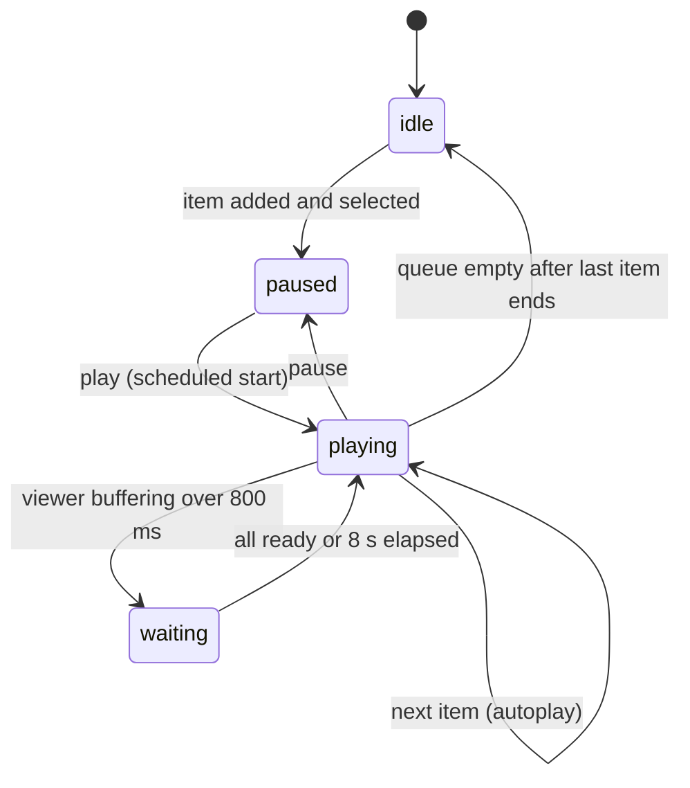

# 20. Watch Together: feature design

> **Status: Proposed (planning only, 2026-11-02).** Decision record: [19](19-watch-together-adr.md). Security: [security/watch-together-review.md](security/watch-together-review.md). Plan: [21](21-watch-together-plan.md). Numbers marked *start value* are first guesses to be tuned in spikes S1 and S2, not measured results. Facts about external services carry the *verified* or *unverified* marks of 19.

## 1. Summary

A third channel type, `watch`. Members add videos to a shared **queue**; everyone who has pressed **Join** sees the same item at the same position. Play, pause, seek and next are commands to the server, which keeps one authoritative room clock and tells everybody; each client steers its own player toward that clock. The channel shows who is watching. The first player is a plain HTML5 `<video>` (own uploads and allow-listed hosts); YouTube is an opt-in second adapter (19 §5). Chat beside the video reuses an existing text channel (§10).

## 2. Requirements

IDs `R-W-nnn` follow the style of 01 §5. MUST / SHOULD / MAY as in 00.

### 2.1 Channel and queue
- R-W-001 MUST provide a `watch` channel type that obeys the same visibility rules as other channels (404 for a channel the caller cannot view; 11 §2.5, 07 M2 note).
- R-W-002 MUST keep an ordered queue per channel; members with `ADD_WATCH_ITEMS` add by URL (end, or "play next"); duplicates warn but are allowed.
- R-W-003 MUST let the adder remove their own item and `MANAGE_WATCH_QUEUE` holders remove any, reorder and clear; removals record who and why.
- R-W-004 MUST keep a history of played items (default 200 or 90 days, whichever is fewer) so an item can be re-queued.
- R-W-005 SHOULD support "vote to skip" with a per-channel threshold (off by default).
- R-W-006 MUST advance to the next item automatically when the current one ends (per-channel switch, default on) and go idle when the queue is empty.
- R-W-007 MAY import a provider playlist (deferred: no keyless route verified, 19 §2). "Playlist" in v1 means the channel's own queue.

### 2.2 Playback and sync
- R-W-010 MUST give every joined viewer the same position within a target of **±300 ms for HTML5 and ±600 ms for YouTube** (*start values*), measured as steady-state error after convergence.
- R-W-011 MUST support play, pause, seek and next/previous for members the channel's control mode allows (§5.2).
- R-W-012 MUST show a late joiner the current item at the current position without disturbing others.
- R-W-013 MUST handle one viewer buffering without silently desyncing the rest (§6.5): a bounded group wait.
- R-W-014 MUST recover from reconnects, background tabs and the server restarting without human action beyond tapping Join when the browser requires a gesture.
- R-W-015 MUST NOT require the server to hold or relay the media of an external provider (19 §5.6).
- R-W-016 SHOULD show each viewer a plain sync state ("In sync", "Catching up", "Out of sync, tap to resync") that is not colour-only.

### 2.3 Presence and moderation
- R-W-020 MUST show who is watching (joined viewers), visible to everyone who can view the channel; a viewer is told they are visible (like R-046).
- R-W-021 MUST treat joining as opt-in: opening the channel alone loads no provider content and sends no third-party request (08 §4.2 pattern).
- R-W-022 MUST audit item adds, removals, blocklist changes, channel setting changes and forced removals.
- R-W-023 MUST provide an instance blocklist (host, provider+ID, URL prefix) that rejects new items and removes matching queued items.
- R-W-024 MUST remove a viewer's ability to add or control, and the viewer's presence, within one reconciliation interval of losing `VIEW_CHANNEL`, a ban or kick (as S-16 does for voice).

### 2.4 Privacy, safety and operations
- R-W-030 MUST be off by default (`modules.watch.enabled`), and each external provider off by default (19 §5.3).
- R-W-031 MUST NOT load third-party script, frames, images or fonts until the Host enabled that provider **and** the member accepted the provider notice (§11).
- R-W-032 MUST NOT fetch member-supplied URLs on the server (19 §5.7, security review §3).
- R-W-033 MUST render titles and URLs as inert text (S-06).
- R-W-034 MUST expose metrics and limits (§12, §13) and answer `FEATURE_DISABLED` when off (04 §7).
- R-W-035 SHOULD work on phone browsers within the limits of §9.2.

## 3. User stories

| # | As a | I want | So that |
|---|---|---|---|
| U1 | Member | to paste a YouTube link into the watch channel and see it queue with its title | friends can see what is next |
| U2 | Member | to press Join and be on the same second as everyone | we laugh at the same moment |
| U3 | Member | to pause for everyone when someone needs a break, and see who did | no one misses a scene |
| U4 | Member who joined late | to land on the current moment without pausing the others | we do not restart |
| U5 | Member on slow wifi | the room to wait briefly rather than leave me behind, but not forever | I can keep up without ruining it for others |
| U6 | Member | to talk while watching (voice) and chat beside the video | it feels like a couch |
| U7 | Moderator | to remove a link and block that host or video | abuse stops |
| U8 | Host | to leave third-party providers off, or to turn on one provider knowing what it sends | I stay in charge of privacy |
| U9 | Host | to see in the audit log who added what | I can answer a complaint |
| U10 | Phone user | to join, see the video and the queue, add a link | I am not locked out |
| U11 | Screen reader user | to know what is playing and who changed it | I am not guessing |

## 4. Architecture placement

```
 apps/web   modules/watch/         WatchView, QueuePanel, AddBar, SyncController (pure), adapters/
                                      html5.ts  youtube.ts  (peertube.ts later)  fake.ts (tests)
 packages/shared  src/watch/       zod schemas, wire types, URL canonicaliser, sync maths (pure, no DOM)
 packages/safe-fetch (new)         hardened outbound fetch (also for link-previews)
 apps/server  modules/watch/       index.ts schema.ts service.ts room.ts routes.ts gateway.ts metadata.ts api.ts
```

- Module id `watch`; `dependsOn: ["channels", "roles"]`; `optionalDependsOn: ["uploads"]` (own-file items), `["audit-log"]` (works through the event bus). Needs ports: `db`. It never imports another module; it reads channel facts and permissions through `ChannelsApi` and `RolesApi` (04 §5, enforced by `tools/eslint/module-boundary.js`).
- `channels` learns one new type string; the `watch` module registers a settings validator for it. No change to `text-chat`, `voice` or `livekit`. A watch channel and a voice channel are independent: a member can be in a voice call (bottom bar, 12 §6) while watching, so "watch with voice" needs no coupling and **keeps voice E2EE as it is** (§11).
- The module is only registered when enabled, so a disabled module has no routes, no gateway ops and no tables touched (04 §1). Tables stay on disable (04 §5).

## 5. Permissions

### 5.1 New bits
Allocated after 26 (11 §2.2), names in the style of the catalogue.

| Bit | Name | Scope | Meaning |
|---|---|---|---|
| 27 | `ADD_WATCH_ITEMS` | watch | Add items by link |
| 28 | `CONTROL_PLAYBACK` | watch | Play, pause, seek, next/previous (subject to the channel's control mode) |
| 29 | `MANAGE_WATCH_QUEUE` | watch | Remove any item, reorder, clear, lock the queue, change the channel's watch settings, override control mode |
| 30 | `ADD_WATCH_FILES` | watch | Put an own uploaded file on the queue (needs the `uploads` module and the user's quota) |

`VIEW_CHANNEL` (bit 0) is "can open the channel and join". Blocklist management uses `MANAGE_INSTANCE`; creating the channel uses `MANAGE_CHANNELS`.

Defaults (editable by the Host, 11 §2.2): `@everyone` gets `ADD_WATCH_ITEMS` and `CONTROL_PLAYBACK` (friends-sized groups; Hosts of larger instances remove the second); Moderator adds `MANAGE_WATCH_QUEUE`; Admin adds `ADD_WATCH_FILES`. A timeout removes `ADD_WATCH_ITEMS`, `CONTROL_PLAYBACK` and `ADD_WATCH_FILES` (`TIMEOUT_REMOVES`, view stays). Existing instances: a one-time migration step adds the defaults to the default roles the first time the module runs (a `watch_meta` row records it so a Host's later edits are never overwritten).

### 5.2 Code changes this needs (small, with tests, first task of the plan)
- `ChannelKind` becomes `"text" | "voice" | "watch"`; `channelKindMask("watch")` is `VIEW_CHANNEL | bits 27..30`.
- **`CHANNEL_SCOPED` is the contiguous mask of bits 0 to 14**, and every one of those 15 bits is taken. A channel overwrite can only touch bits in that mask (11, `packages/shared/src/permissions.ts`). It must become an explicit set (`0..14` plus `27..30`) or the new bits could not be overwritten per channel. Stored overwrites are unaffected. A test pins the set so a later bit cannot be forgotten.
- `authz.matrix.test.ts` gains the watch routes (every endpoint × role × channel situation).

### 5.3 Control mode (channel setting `controlMode`)
| Mode | Who may send play, pause, seek, next |
|---|---|
| `everyone` (default) | everyone with `CONTROL_PLAYBACK` |
| `queuer` | the member who queued the current item, plus `MANAGE_WATCH_QUEUE` |
| `managers` | `MANAGE_WATCH_QUEUE` holders only |

Everyone else's local controls are disabled and their own native seek or pause is **reverted** to the room state (SyncTube does the same for non-leaders), with a one-line explanation. `MANAGE_WATCH_QUEUE` can also **lock** the queue (no adds) during a moderation incident.

## 6. Sync protocol

### 6.1 Principles
1. **One authority.** The server owns the room clock; clients never decide among themselves (not peer-to-peer).
2. **Anchor model, no tick loop** (as SyncTube's `VideoTimer`): the server stores `(positionMs, anchorMs)` and computes the position on demand. Nothing is written while a video plays, so a playing room costs the single SQLite node nothing between commands (ADR-007).
3. **Commands, not positions, are broadcast.** A state change carries `(positionMs, anchorMs, status, epoch)`; clients extrapolate with their own estimate of the server clock.
4. **Start is scheduled in the future** (Jellyfin schedules `Unpause` after about twice the highest ping) so every client has time to seek and be ready at the same moment.
5. **Correction is gentle and cheap**: nudge the playback rate for small gaps, seek for big ones, and never correct while the player is seeking or buffering.
6. **The server is not trusted for ordering by clients and clients are not trusted by the server**: the server serialises commands per room and validates permissions, `itemId` and rate limits; a client can only ask.

### 6.2 State

```ts
interface RoomState {
  channelId: string;
  itemId: string | null;          // current queue item, null = idle
  status: "idle" | "paused" | "playing" | "waiting";  // waiting = group wait for a buffering viewer
  positionMs: number;             // position at anchorMs (or the frozen position when not playing)
  anchorMs: number;               // server clock (ms since epoch) at which positionMs holds; may be in the future (scheduled start)
  epoch: number;                  // +1 on every change; clients ignore older epochs
  updatedBy: string | null;       // user id of the member whose command caused it (or null: automatic)
  waitingFor?: string[];          // user ids, when status = "waiting"
  waitUntilMs?: number;           // server clock; the wait ends by then at the latest
}
// position at server time t:
//   playing: t < anchorMs ? positionMs : positionMs + (t - anchorMs)      (rate is 1 in v1)
//   else:    positionMs
```

The room playback rate is fixed at 1 in v1: providers disagree (Vimeo rate control needs a paid owner account; YouTube's list is discrete; 19 §2), and rate is used only as a *local* correction tool.

### 6.3 Clock sync (client to server)
Over the gateway as command `clock.ping {t0}` answered by `COMMAND_RESULT {t0, t1, t2}` (server receive and send times). Same algorithm as Jellyfin's (verified): offset = ((t1 − t0) + (t2 − t3)) / 2, delay = (t3 − t0) − (t2 − t1); keep the last 8 samples and use the **minimum-delay** one. *Start values:* 5 pings 200 ms apart when a viewer joins (faster than Jellyfin's 3 at 1 s), then one every 30 s; rate limit 10 per 10 s per socket. The measured RTT is also reported to the server inside `watch.join` and `watch.buffering` so it can choose the start lead (§6.4). Server time must come from one clock (`Date.now()` on the node); NTP quality on the Host matters (the sync error on the viewer side is only about the *difference* between viewers' offsets, so a common server error cancels).

### 6.4 Commands and events

Gateway commands (op 4, 07 §4.6). Every command has `channelId`, the `itemId` it applies to (so a late "pause" for item A cannot pause item B: the server answers `STALE_ITEM` and sends the current state), and a client `seq` for idempotent retries (duplicates within 30 s return the previous result).

| cmd | args | Who | Server effect |
|---|---|---|---|
| `watch.join` | `{channelId, rttMs}` | any with VIEW_CHANNEL | add to viewers; result carries the full `RoomState` and `serverNowMs` |
| `watch.leave` | `{channelId}` | viewer | remove |
| `watch.play` | `{itemId, positionMs?}` | CONTROL | if paused/idle: `status=playing`, `positionMs` = given or current, `anchorMs = now + lead` |
| `watch.pause` | `{itemId, positionMs}` | CONTROL | freeze at the room's own computed position (the client value is used only if within 2 s of it, otherwise ignored) |
| `watch.seek` | `{itemId, positionMs}` | CONTROL | set `positionMs`; if playing, re-anchor `now + lead` |
| `watch.next` / `watch.prev` | `{itemId}` | CONTROL | change current item (queue order or history) |
| `watch.buffering` | `{itemId, buffering, positionMs, rttMs}` | viewer | wait logic (§6.6) |
| `watch.ended` | `{itemId}` | viewer | advance logic (§6.7) |
| `watch.duration` | `{itemId, durationMs}` | viewer | recorded if the item has none (quorum of 2 agreeing within 1 s, or metadata) |
| `watch.stats` | `{itemId, driftMs, nudges, seeks}` | viewer | only when `modules.watch.debugStats` is on; aggregated into metrics, never stored per user |

`lead = clamp(1.5 × highest viewer RTT, 300 ms, 2000 ms)` (*start values*).

REST (module routes, `/api/v1`, bodies zod-strict, errors per 07 §2.2):

| Method and path | Purpose | Permission |
|---|---|---|
| GET `/watch/channels/:id` | Snapshot: `{state, serverNowMs, queue (up to 200), history (50), viewers, settings}` | VIEW_CHANNEL |
| POST `/watch/channels/:id/items` | `{url, where: "end"\|"next", nonce}` → item (canonicalised, metadata fills in later) | ADD_WATCH_ITEMS |
| POST `/watch/channels/:id/items/file` | `{attachmentId, where, nonce}` own uploaded video | ADD_WATCH_FILES |
| PATCH `/watch/channels/:id/items/:itemId` | `{after: itemId\|null}` reorder | MANAGE_WATCH_QUEUE (or own item) |
| DELETE `/watch/channels/:id/items/:itemId` | `{reason?}` | own item, or MANAGE_WATCH_QUEUE |
| POST `/watch/channels/:id/items/:itemId/skip-vote` · DELETE | vote to skip | VIEW_CHANNEL + joined |
| DELETE `/watch/channels/:id/queue` | clear | MANAGE_WATCH_QUEUE |
| PUT `/watch/channels/:id/lock` · DELETE | lock or unlock adds | MANAGE_WATCH_QUEUE |
| GET/POST `/watch/blocklist` · DELETE `/watch/blocklist/:id` | instance blocklist | MANAGE_INSTANCE |
| GET `/admin/watch` | enabled providers, counts, limits (owner) | owner |

Channel watch settings travel in the existing channel `settings` JSON through the channels PATCH, validated by the `watch` module's schema (`controlMode`, `autoplayNext`, `waitForBuffering`, `maxQueue`, `maxPerUser`, `skipVotePercent`, `allowedProviders`, `chatChannelId`).

Gateway events (dispatch, only to sockets that can view the channel, 07 §4.5):

| Event | Payload |
|---|---|
| `WATCH_STATE` | `RoomState` (+ `serverNowMs` for a sanity check) |
| `WATCH_QUEUE` | `{channelId, op: "add"\|"remove"\|"move"\|"clear"\|"meta"\|"lock", item?, itemId?, after?, by}` |
| `WATCH_VIEWERS` | `{channelId, viewers: [{userId, since}]}` (full list; at most about 50) |
| `WATCH_ENDED_SESSION` | to a user's other tab: `{reason: "joined_elsewhere"}` |
| `WATCH_REMOVED` | to a viewer removed by the reconciler: `{reason: "permission_lost"\|"channel_deleted"\|"kicked"}` |

`READY` carries only a summary per visible watch channel: `{viewerCount, itemTitle?, status}` (like voice presence); the full state comes from the REST snapshot when the channel opens.

### 6.5 Client sync controller (pure, in `packages/shared`)

State: `offsetMs` (clock estimate), `room: RoomState`, adapter handle, `lastCorrectionAt`, `seekLeadMs` (exponential average of how long this adapter takes to finish a seek, start 300 ms).

```
serverNow()  = Date.now() + offsetMs
target()     = room.status == "playing" ? positionAt(serverNow()) : room.positionMs
every 250 ms while playing and the adapter reports "ready" (not seeking, not buffering):
  d = adapter.positionMs() - target()          // positive = ahead of the room
  if |d| < DEADBAND (or already nudging and |d| < DEADBAND/2): rate = 1
  elif |d| < SEEK_AT and now - lastCorrectionAt > COOLDOWN: nudge:
         HTML5:    rate = 1 - clamp(d / 4000, -0.08, +0.08), re-evaluated each tick
         YouTube:  discrete: hold 1.0 below 350 ms; else rate 1 ± 0.25 for |d| / 0.25 ms,
                   then restore, and confirm with onPlaybackRateChange (else fall back to a seek at 700 ms)
  elif |d| >= SEEK_AT: seek to target() + seekLeadMs; lastCorrectionAt = now; COOLDOWN 2 s
```

*Start values:* HTML5 `DEADBAND 60 ms`, `SEEK_AT 1000 ms`; YouTube `DEADBAND 350 ms`, `SEEK_AT 1500 ms`; `COOLDOWN 2000 ms`. For reference the shipped projects use: Jellyfin 60 ms deadband, 400 ms skip, 3 s upper limit for speed correction, 1.5 s between evaluations; Syncplay 0.95× when 1.5 s ahead, 4 s rewind threshold, 1 s seek detection; SyncTube a 2 s threshold (verified, 19 §2). Ours are tighter than Syncplay's and in the same range as Jellyfin's; spike S2 decides.

Rules that prevent the known failure modes:
- **Echo suppression.** Every programmatic adapter call (`play`, `pause`, `seek`, `setRate`) records an expectation `{kind, until: now + 600 ms}`. A player event that matches an unexpired expectation is ours and ignored. Anything else is user-originated: send it as a command if the user may control, otherwise **revert** to the room state. Without this, play commands ping-pong between clients.
- **No correction** while the adapter is `seeking`, `buffering`, or the tab is hidden; on `visibilitychange` to visible, evaluate once at once (a hidden tab's timers are throttled to a crawl, MDN, so drift grows silently, and a paused or throttled player must catch up with a seek).
- **Rate changes are verified** (read back the rate after setting); a player that refuses (the `setPlaybackRate` caveat, Jellyfin's 1.5× report) falls back to seeking.
- **At most one correction per cooldown**, and at most 6 seeks per minute per client; beyond that the client shows "Out of sync, tap to resync" and stops correcting until tapped (prevents a seek storm on a bad connection).
- Scheduled start: the client loads and seeks to `positionMs` immediately, then calls `play()` at `anchorMs` converted to its own clock; if `anchorMs` is already past, it seeks to the extrapolated position and plays at once.

### 6.6 Buffering and the bounded group wait
- A client whose adapter stalls for more than **800 ms** sends `watch.buffering {buffering: true}`; when playback is ready again, `{buffering: false}`.
- If `waitForBuffering` is on (default) and the room is playing, the server sets `status = "waiting"`, freezes `positionMs` at the computed position, lists the stragglers in `waitingFor`, and sets `waitUntilMs = now + 8 s`. Everyone pauses at that position.
- The wait ends when all stragglers report ready, or at `waitUntilMs`, or when a straggler leaves. Then the server schedules a start (`now + lead`) exactly like `watch.play`. A straggler that did not recover is *detached* for that item: it keeps playing on its own, shows "Out of sync", and does not block again for that item.
- Abuse limits: a viewer may trigger at most **2 waits per item**, and a wait never exceeds 8 s; a member can therefore not hold the room hostage (a slow-motion form of griefing).
- When `waitForBuffering` is off, a straggler simply catches up with the drift controller.

### 6.7 End of item and autoplay-next
- A client sends `watch.ended` when its player reports the end **and** its position is within 2 s of the duration. The server advances when a majority of joined viewers (at least 1) have reported, or 3 s after the first report if the others do not answer. It never advances on a single viewer's word when two or more are watching, so one client cannot skip the item for everyone. Position past duration + 2 s with no reports (all players gone) goes idle.
- On advance the server picks the next queued item, marks the last as `played`, sets `status = playing` at 0 with a scheduled start (autoplay-next on) or `paused` at 0 (off).
- Items with unknown duration (YouTube oEmbed has none, 19 §2) get theirs from `watch.duration`.

### 6.8 Late joiners and reconnects
- Join: REST snapshot, clock sync burst, the member presses **Join** (the click is the autoplay gesture and the consent to load provider content), `watch.join` returns the state, the client loads the item, seeks to `target() + seekLeadMs`, and plays if `status == playing`. Nobody else is paused or disturbed.
- Gateway drop and resume: the viewer entry lives for **10 s** after a socket closes (so a Wi-Fi flap does not announce a leave); on `RESUME` the missed `WATCH_STATE` events replay (07 §4.3); on a non-resumable reconnect the client re-fetches the snapshot and re-joins (the join gesture is already satisfied, so no tap is needed unless the browser has since blocked playback).
- A second tab or device: the newest `watch.join` wins; the older tab gets `WATCH_ENDED_SESSION` and stops playing (as voice does for `joined_elsewhere`, 08 §4.5).
- Server restart: room state is in the table `watch_room`. On boot a room that was `playing` and went down for **less than 15 s** keeps playing (the anchor is still valid); otherwise it is paused at the last known computed position, written on graceful shutdown or taken from the last command. Clients see the gateway drop and re-join as above.

### 6.9 Latency on a single SQLite node
A command costs one hop in, one transaction (one row in `watch_room`, `begin immediate`, a few milliseconds at worst; the 05 §3.1 notes say writes stay on the event loop), then fan-out to at most a few dozen sockets. Spike T1 measured gateway fan-out for 1,000 sockets at 50 msg/s at about 10 ms p99 (03 ADR-005). The expected end-to-end command latency is therefore dominated by the network, not the node; the scheduled start (`lead` of at least 300 ms) absorbs it. The server persists **before** it broadcasts (07 §5), and a failed write rejects the command instead of letting memory and disk disagree. **Spike S1 measures this on the real deployment path** rather than trusting the arithmetic.

### 6.10 Sequence diagrams







## 7. Data model (module `watch`, tables owned by it)

Conventions as 06 §1 (text ULID ids, integer ms timestamps, `space_id` on scoped tables, soft delete). The module never queries another module's tables; item `added_by` and channel ids are plain values checked through `ChannelsApi` and the accounts API.

**watch_room** (one row per watch channel, created lazily)
| col | type | notes |
|---|---|---|
| channel_id | FK channel PK | |
| space_id | FK | |
| item_id | FK watch_item? | current item |
| status | text | idle, paused, playing, waiting (waiting is persisted as paused at the frozen position; the wait is memory only) |
| position_ms, anchor_ms | int | as §6.2 |
| epoch | int | |
| locked | bool | queue lock |
| updated_by | FK user? | |
| updated_at | ts | |

**watch_item**
| col | type | notes |
|---|---|---|
| id | id | ULID |
| channel_id | FK | index `(channel_id, status, sort_key)` |
| space_id | FK | |
| provider | text | `html5`, `upload`, `youtube`, later `peertube`, `vimeo` |
| provider_ref | text | canonical reference: YouTube 11-character ID, upload attachment id, or the canonical https URL for `html5` (never used verbatim as an `src` without the §7 rules in the security review) |
| start_ms | int? | optional start offset from `t=`/`start=` |
| title, author | text? | stored with length limit, control and bidi characters stripped; may be null |
| duration_ms | int? | from metadata or `watch.duration` |
| meta_fetched_at | ts? | drives the 30-day retention rule for YouTube-derived text (19 §2, unverified) |
| sort_key | text | fractional index (`between(a,b)`); rebalanced when a key gets longer than 64 characters |
| status | text | `queued`, `playing`, `played`, `removed` |
| added_by | FK user | |
| added_at | ts | |
| played_at | ts? | |
| removed_by | FK user? | |
| removed_at | ts? | |
| removed_reason | text? | `own`, `moderation`, `blocked`, `channel_deleted`, `expired`, free text ≤ 200 |
Indexes: `(channel_id, status, sort_key)`; `(channel_id, added_by, status)` for the per-member limit; `(provider, provider_ref)` for blocklist sweeps.

**watch_skip_vote** `(item_id, user_id)` PK, `created_at`. Cleared when the item stops being current.

**watch_blocklist** : id, space_id, kind (`host`, `provider_ref`, `url_prefix`), pattern, reason?, created_by, created_at. Unique `(space_id, kind, pattern)`.

**watch_meta** : key, value (e.g. `defaults_applied`).

**Not stored:** viewer presence, clock offsets, buffering flags, the group wait (memory only, like voice presence). Thumbnails (§11) are not in the database.

Retention jobs (`ctx.jobs`, 04 §3): purge history beyond the limits; null `title`, `author` for `youtube` items older than 29 days since `meta_fetched_at` (the UI falls back to "YouTube video" and the next open refetches through the allowed oEmbed call); remove `removed` items older than 30 days. Backups include the tables (they are ordinary rows; 14 §7).

## 8. Metadata fetching

| Provider | How | Server request |
|---|---|---|
| `youtube` | Extract the 11-character ID with a strict pattern (`[A-Za-z0-9_-]{11}`) from `youtube.com/watch?v=`, `youtu.be/`, `youtube.com/shorts/`, `youtube.com/embed/`, and `m.`/`music.` hosts only | `GET https://www.youtube.com/oembed?url=https://www.youtube.com/watch?v=<ID>&format=json`, **built by the server from the ID** (verified to return title, author, thumbnail and no duration, with no key) |
| `vimeo` (later) | numeric ID | fixed `https://vimeo.com/api/oembed.json?url=https://vimeo.com/<ID>` (verified; includes duration) |
| `peertube` (later) | host must be in `modules.watch.providers.peertube.instances`; ID is a short UUID | oEmbed on the allow-listed instance through `safe-fetch` (**unverified**: the instance oEmbed endpoint and its fields) |
| `html5` | URL must be `https`, host in the allow-list (or `anyHttpsHost` set by the Host), path ends in a known video extension | **No server request.** The title is the file name; duration comes from the first viewer (`watch.duration`) |
| `upload` | an attachment id | read from the `uploads` module through its API; no network |

All requests go through `packages/safe-fetch` with a 3 s timeout, 64 KiB response cap, no redirects followed (a redirect makes the add fail soft: title stays empty), no cookies, a fixed `User-Agent`. At most 10 fresh fetches a minute instance-wide and 5 per member per 10 s; results cached by `(provider, id)` for 24 h in memory. A failed fetch never blocks an add: the item shows "YouTube video (<id>)". **Thumbnails are off in v1** (title, author, provider icon only), because showing a thumbnail from `i.ytimg.com` would be a third-party image request before the member consented; an opt-in `thumbnails: proxy` (server fetch of the fixed host, cached on disk for at most 24 h, served from our origin) is a later option, subject to the retention question above.

## 9. UI behaviour

### 9.1 Desktop
Layout reuses the shell (12 §4, design U-series): channel list left, **stage** centre, **side panel** right with tabs *Up next*, *History*, *Watching*; member list stays an overlay below 1280 px (design U8).

```
┌ #movie-night  ▸ Watching: 4 · Alex is in control ──────────────────────────┐
│  ┌────────────────────────────────────────┐ ┌ Up next ─ History ─ Watching ┐│
│  │                                        │ │ ▶ Now: Title (YouTube)       ││
│  │              player stage              │ │ 1. Title            ⋮ Alex   ││
│  │        (provider UI untouched,         │ │ 2. Title            ⋮ Sam    ││
│  │         nothing drawn on top)          │ │ + Add a link or file…        ││
│  └────────────────────────────────────────┘ └──────────────────────────────┘│
│  ⏯  ──●────────────  12:31 / 45:10   ⏭  🔊━━   ✔ In sync   [Resync]  Chat ▸ │
└─────────────────────────────────────────────────────────────────────────────┘
```

- The transport bar is **below** the stage and never overlays the player (YouTube RMF forbids anything in front of the player including controls, verified). Provider consent and "tap to join" prompts also sit beside or under the stage, never on it.
- Before **Join** the stage shows a poster area with the item title, who is watching, a **Join** button and, for a provider that needs it, a one-paragraph notice (§11). Nothing from a provider has loaded.
- Add bar: paste a link, press Enter; the item appears at once with its title when oEmbed answers; errors are specific ("This host is not allowed", "YouTube is not enabled on this server", "Already in the queue").
- Queue: drag to reorder (keyboard: move up/down buttons), per-item menu (remove, play now if allowed, copy link), badge for who added it. Moderators see "Remove and block this video/host".
- Volume and mute are **local** (never synced). Fullscreen is the provider's or the browser's.
- For a YouTube item the provider's own controls stay visible (we do not hide them), so native play, pause and seek are possible; they are converted to commands or reverted per §6.5.
- Picture-in-picture for HTML5 items through the browser button; YouTube PiP is the browser's business.

### 9.2 Phone and PWA
- Stage on top at full width (not below 200×200; target 16:9 at 360 px wide is above YouTube's minimum, verified at 200×200); the queue is a bottom sheet; the add bar sits at the top of the sheet; **Join is one large button** and is also the autoplay gesture. Safari needs `playsinline` (verified); Vimeo's player cannot be started programmatically on iOS (verified), so a remote "play" for an iOS Vimeo viewer shows "Tap to play". YouTube background playback is not allowed by policy and a locked screen pauses it; on return the client resyncs with a seek. Whether an installed PWA keeps HTML5 audio playing in the background is **unverified** (spike S5).
- Media Session metadata and lock-screen controls only for HTML5 items and only where the API exists (limited availability, verified).
- Reduced data: no thumbnails, no autoloading of the next item.

### 9.3 Accessibility (N-011)
Keyboard: Space toggles play if the member may control, `←`/`→` seek 5 s with the same permission rule, `N` next; shortcuts are inactive while an input has focus and never override the browser inside the YouTube frame (focus order stage, transport, queue, add bar). The seek bar is a labelled slider with `aria-valuetext` "12 minutes 31 seconds of 45 minutes". A polite live region announces "Alex paused", "Now playing: <title>", "Waiting for Sam", "Out of sync"; the sync state has text and an icon, not only colour; `prefers-reduced-motion` removes the queue animations; captions are the provider's own, and for HTML5 items an optional WebVTT `<track>` is a later task.

### 9.4 Settings
- Per channel (Settings, Channels, edit, *Watch* section, needs `MANAGE_WATCH_QUEUE` or `MANAGE_CHANNELS`): control mode, autoplay next, wait for buffering, queue limits, skip-vote percent, allowed providers, linked chat channel.
- Per server (Host): enable the module and providers, the HTML5 host allow-list, PeerTube instances, limits, blocklist (UI under Settings, Server; CLI `tincan watch …` for the config parts). Provider switches change the CSP, so the UI says "run `tincan config apply` and reload Caddy" (§13).
- Per member (Settings, Appearance or a *Watch* page): remembered acceptance of each provider notice (a synced user setting `watch.provider.youtube.accepted`, which the member can clear), "Duck the video while others speak" (§10), "Mute video when I am speaking" is not planned.

## 10. Voice and chat alongside

- **Voice:** independent, as in §4. Echo is the practical concern: video audio played through speakers reaches the microphone, and the browser's echo cancellation works on audio it renders for the call; whether it also cancels a cross-origin iframe's audio is **unverified** (spike S5). The UI recommends headphones; an optional **auto-duck** lowers the local video volume while someone in the member's voice call is speaking (client-side, from LiveKit speaking events, no server change).
- **Chat:** a watch channel does **not** contain messages (text-chat only accepts `text` channels, `text-chat/service.ts`). The channel setting `chatChannelId` points to an existing visible text channel; the client shows it in a side pane with the existing text-chat client module (design U3 deferred a general split view; this is the same idea limited to this view). If unset, the "Chat" button offers to create a paired text channel (the Q5 pattern: admins pair channels by hand).

## 11. E2EE, privacy and what the UI promises

- **Voice and screenshare E2EE** are unchanged (10). A watch channel creates no E2EE state and has no E2EE setting.
- **Queue, titles, who is watching, positions and commands** go through the app server in the clear (like text): the Host can see what is queued and who watches (ADR-011 trust model). The UI text in the channel info: "Watch Together is not end-to-end encrypted. The server admin can see what is queued and who is watching."
- **Embedded providers see the viewer.** For YouTube: the member's IP address and the usual request headers go to Google when the player loads; privacy-enhanced mode makes views not influence personalisation (verified), but what it sets before play is not documented (spike S4). The notice shown before the first YouTube item loads (and kept as a setting) says that in plain words and links the provider's own terms and privacy policy, which the API terms require anyway (verified). The **HTML5 adapter with own uploads sends nothing to third parties**; a direct URL on an allow-listed host sends the viewer's IP to that host.
- **Screenshare fallback** is the only path that keeps media end-to-end encrypted; the UI mentions it when a link is refused ("This host is not allowed. You can share your screen in a voice channel instead").
- **Opt-in at three levels:** Host enables the provider; the channel allows it (`allowedProviders`); the member accepts the notice. Disabling any level stops loading it.

## 12. Limits, rate limits, metrics

| Limit | Default |
|---|---|
| Items in a queue | 200 (channel setting, cap from config) |
| Queued items per member | 20 |
| Title length stored | 200 characters |
| Add item | 5 per 10 s per member, 30 per hour per member |
| Playback commands | 10 per 5 s per member per channel (play, pause, seek, next) |
| `clock.ping` | 10 per 10 s per socket |
| `watch.buffering` | 10 per 10 s per socket |
| Viewers per room | 50 (config) |
| Rooms with viewers per node | 100 (config, soft warning) |
| Fresh metadata fetches | 10 per minute per instance, 5 per member per 10 s |
| Gateway frame | unchanged, 64 KiB (07 §4.1) |

Metrics (module `metrics`, ADR-017), labels bounded, no user ids or URLs:
`tincan_watch_rooms_active`, `tincan_watch_viewers`, `tincan_watch_commands_total{type,result}`, `tincan_watch_command_seconds` (server handling), `tincan_watch_waits_total{outcome}` (resolved, timed_out, detached), `tincan_watch_items_total{provider,outcome}` (added, rejected_blocklist, rejected_host, rejected_disabled), `tincan_watch_metadata_total{provider,outcome}` (ok, timeout, error, rate_limited), `tincan_watch_state_epoch_conflicts_total` (stale item), `tincan_watch_reconciler_removals_total{reason}`. With `debugStats` on: `tincan_watch_client_drift_ms` histogram and `tincan_watch_client_seeks_total`. Logs carry route shape, channel id and request id only: no URLs of items in info logs (a URL can contain a token), and no titles.

## 13. Rollout, flags and Caddy

- **Capability:** `GET /capabilities` gains `features.watch: { providers: ["html5","youtube"], maxQueue, upload: true|false }` only when the module is on (04 §7); clients hide the channel type otherwise; the gateway answers `FEATURE_DISABLED`.
- **Config** (04 §9):

```yaml
modules:
  watch:
    enabled: false                    # off by default
    providers:
      html5:   { hosts: [], anyHttpsHost: false }   # exact hostnames; own uploads always allowed when uploads is on
      youtube: { enabled: false }
      peertube: { instances: [] }                  # later
    limits: { queueMax: 200, perMemberQueued: 20, viewersMax: 50 }
    debugStats: false
```
- **Caddy/CSP:** `tincan init` and a new `tincan config apply` (regenerate Caddyfile from config, validate, reload) add only what is enabled. With YouTube on: `frame-src https://www.youtube-nocookie.com`; `script-src … https://www.youtube.com` (the IFrame API loader; further script hosts it pulls in, for example `s.ytimg.com`, are **unverified** and measured in S3/S4); `img-src` unchanged because thumbnails are off. With the HTML5 allow-list: `media-src 'self' blob: https://host…`. With `anyHttpsHost`: `media-src https:`, flagged in `tincan doctor` as a warning. Default (off): the header is exactly today's (`frame-src` falls back to `default-src 'self'`, verified in MDN). `Permissions-Policy` stays as shipped (`autoplay` and `fullscreen` default to `self`; the provider iframe receives them through its `allow` attribute, verified). `Referrer-Policy: no-referrer` stays site-wide; the YouTube iframe carries `referrerpolicy="strict-origin-when-cross-origin"` for the Referer YouTube requires (S3 confirms that the API honours it).
- **Migration:** module migration creates the tables (forward only, 06 §8); the `watch_meta` row applies the default permission bits; a pre-existing instance is unaffected until `enabled: true`. Disabling keeps data.
- **Staged rollout:** (1) enabled on the author's instance with HTML5 only; (2) YouTube behind its own flag for the friends group; (3) uploads last. Each stage ships as a minor release with a CHANGELOG entry that says what is new and what a Host must change (the "Before you upgrade" convention).

## 14. Failure modes

| Failure | Behaviour |
|---|---|
| Provider embed breaks (script blocked, API change) | Adapter reports `error`; the room keeps its state; the viewer sees "Could not load YouTube" with a *Skip for me* and a link to open the video directly; the room is not stopped for everyone |
| Video blocked by region, age, private, or embedding disabled (YouTube errors 100, 101, 150) | The viewer sees the reason; the room is not stopped; an optional per-item "unavailable for N viewers" badge (viewers report it) lets a manager skip |
| Missing Referer (error 153) | Detected by code; viewer is told to contact the Host; `tincan doctor` checks the Referrer-Policy path (S3) |
| Ads in the YouTube player | Cannot be blocked (policy). The viewer in an ad is out of position; the controller does not correct during an ad if the player reports a different duration or state (**unverified**: how the API reports ads, S3); the room continues and the viewer catches up afterwards |
| Browser blocks autoplay | `play()` rejects with `NotAllowedError` (or `onAutoplayBlocked` for YouTube); show "Tap to start" beside the stage; once tapped, the room continues |
| Viewer's tab hidden, device sleeps | Resync with a seek on return; YouTube background playback is not provided |
| Seek storm (several controllers) | Server serialises, rate limit 10 per 5 s, last command wins; controllers see who changed it |
| A viewer's clock offset is wrong | Doesn't matter for the others; their own error is bounded by the seek threshold and the "Out of sync" message after repeated seeks |
| Server restart | §6.8 |
| Gateway congestion (slow consumer, close 4010) | Client reconnects and resumes; state replays; if not resumable the client re-fetches |
| Item unplayable by everyone | After a majority of viewers report an error, the server pauses and marks the item `unavailable`, announcing it; a manager can skip or the room waits |
| Abuse link, illegal content | Remove, block, audit (§2.3, security review §6) |
| `controlMode` change mid-play | Takes effect on the next command; viewers who lose control are told |
| Module disabled while rooms are active | Gateway stops accepting watch ops; viewers get `WATCH_REMOVED {reason: "feature_disabled"}` and the client falls back to the channel list |
| Uploaded file deleted by its owner or quota job while queued | Item becomes `removed` with reason `expired` and the room moves on |

## 15. Test hooks
See [21 §5](21-watch-together-plan.md): pure sync library with a deterministic simulator, fake adapters, a real two-browser media test, authorisation matrix rows, SSRF suite, CSP and header tests, and the QA checklist [qa/watch-together.md](qa/watch-together.md).

## Open items
- Owner decisions: [22](22-watch-together-owner-memo.md).
- Spikes that may change numbers here: S1 (clock and latency), S2 (drift control), S3 (YouTube), S4 (privacy capture), S5 (mobile and echo), S6 (uploads and Range), S7 (policy text).
- Whether `watch` channels should later hold their own messages (rather than a linked text channel).
- Room playback speed (v1.1) and repeat modes (v1.1).
